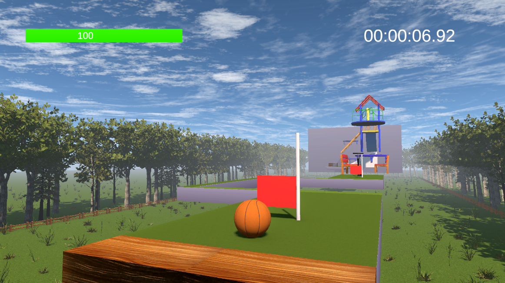

# BALLTRAVEL

**バスケットボールを転がして、ゴールのバスケットリングを目指す3Dボール転がしアクション。**

『LOST EGG』をリスペクトした作品で、「卵」を「バスケットボール」に、「フライパン」を「バスケットゴール」に置き換えています。
公園や体育館など身近な場所を、小さなボールの目線で旅するゆるいアクションゲームです。

| ゲーム画面 | クリア画面 |
| :---: | :---: |
|  |  |

---

## 操作方法

| 操作 | キー |
| --- | --- |
| 移動 | W / A / S / D(矢印キーも可) |
| 視点移動 | マウス |
| ジャンプ | Space |
| ためジャンプ | Shift(踏ん張り)を押しながら Space を押し続け、Space を離すと跳ぶ |
| ポーズ | Esc |

- 移動はカメラの向きが基準。入力をやめると少しずつ減速して止まります。
- ためジャンプは押している時間に応じてジャンプ力が上がり、ゲージで確認できます。

## ゲームの流れ

- タイトル → チュートリアル / ステージ選択
- トゲに触れると体力が少しずつ減り、0 になるとゲームオーバー
- チェックポイントを通ると、そこからリトライ可能
- ゴール(バスケットリング)に入るとクリア。クリアタイムに応じて S / A / B / C のランク評価

## ステージ

| ステージ | テーマ | 状態 |
| --- | --- | --- |
| チュートリアル | 操作練習 | 完成 |
| Stage1 | 公園(芝生 → 遊具 → スケートパーク) | 完成 |
| Stage2 | 体育館(マット → 動くカゴ → キャットウォーク) | 制作中 |
| Stage3 | 未定 | 未着手 |

## ギミック

| ギミック | 内容 |
| --- | --- |
| トゲ(Hari) | 触れると継続ダメージ |
| 空気入れ(HealAirPump) | 触れると体力回復。使うと消える |
| チェックポイント | リスポーン地点を更新。旗が立つ |
| トランポリン | 大きく跳ねる。DOTween で縮んで戻るアニメーション |
| 扇風機(Fan) | 風で押し出す。距離で風が弱まり、ON/OFF の間隔を設定可能 |
| 動く床(MoveGround) | 空オブジェクトで経路を指定。ループ / 往復、区間ごとの秒数・待ち時間を設定可能 |
| せり上がる床(RiseGround) | チェックポイント通過で床が出てきて、先に進めるようになる |
| 回転床(RotateGround) | 回り続ける足場 |

---

## 工夫したところ

### ① イベント駆動の GameManager
クリア・ゲームオーバー・ポーズ・リトライ・チェックポイント到達を `GameManager` のイベント(`OnGameClear` / `OnGameOver` / `OnPausing` / `OnRespawn` / `OnCheckPointReached` など)として発行し、プレイヤー・UI・ギミックがそれぞれ購読して動く形にしました。
GameManager が個々のオブジェクトを知らなくて済むので、ギミックを追加しても GameManager を書き換えずに済みます。

`GameManager` は `RuntimeInitializeOnLoadMethod` で Resources から自動生成しているので、どのシーンから再生しても必ず存在します(シーンに置き忘れる事故がない)。

### ② ポーズで `Time.timeScale` を使わない
ポーズ時は `Time.timeScale = 0` にせず、各オブジェクトがポーズイベントを購読して自分で止まる設計にしました。

- プレイヤー: 止まる直前の速度を保存 → Rigidbody を止める → 解除時に速度を戻して、そのまま続きから動く
- 動く床・回転床・トランポリン: DOTween をまとめて一時停止 / 再開
- 入力: ポーズ中はプレイヤー操作のマップだけ無効にし、ポーズ解除のキーは生かしておく

UI アニメーションなど「ポーズ中も動いてほしいもの」を個別に例外扱いしなくてよくなります。

### ③ シーンを読み直さないチェックポイント復帰
リトライはシーンを再読み込みせず、**チェックポイントに最初に触れた瞬間の状態**に戻します。

- 位置・向き
- 経過タイム(タイムアタックの公平さのため)
- 体力(チェックポイントでは回復しない)
- 空気入れ:チェックポイント前に使ったものは消えたまま、後に使ったものは復活

それぞれのスクリプトが `OnCheckPointReached` で自分の状態を保存し、`OnRespawn` で戻すので、復元処理が1か所に集中しません。

### ④ ためジャンプ
Shift で踏ん張りながら Space を押し続けると、最小〜最大ジャンプ力の間で力がたまり、ゲージに反映されます。接地判定はレイキャストで、地面タグの付いた床に立っているときだけ跳べます。

### ⑤ 動く床にボールが乗れるように
動く床は Kinematic Rigidbody で動かし、上に乗っているボールを床の移動量ぶん一緒に動かしています。乗った瞬間・降りた瞬間に振り落とされないよう、少しだけ猶予時間を設けました。

### ⑥ ステージ制作ツールの自作
草や小物をランダムに配置するエディタ拡張「Scatter ツール」を作りました。ポアソンディスクサンプリングで、重なりすぎず自然な間隔で散らせます。

### ⑦ 命名・構成ルールの統一
プロパティは PascalCase、bool は `_isXxx`、イベントは `On〜`、名前空間はフォルダ構成と一致させる、などのルールを決めて全スクリプトを統一しました。

---

## 開発環境

| 項目 | 内容 |
| --- | --- |
| エンジン | Unity 6(6000.3.13f1) |
| レンダーパイプライン | URP |
| 言語 | C# |
| 主なパッケージ | Input System / Cinemachine / UniTask / DOTween / VFX Graph / TextMesh Pro |
| 対応プラットフォーム | Windows |

## 制作情報

| 項目 | 内容 |
| --- | --- |
| 制作期間 | 約4か月(制作中) |
| 制作人数 | 1人(個人制作) |

## フォルダ構成(スクリプト)

```
Assets/BallTravel_Remake/Scripts/
├─ Common/          共通処理
├─ Managers/        GameManager, SceneController, AudioManager, 入力, ステージ管理
├─ Player/          移動・ジャンプ, カメラ, 体力, 入力, SE
├─ Stage/Gimmick/   各ギミック, チェックポイント, ゴール
└─ UI/              タイトル, クリア, ゲームオーバー, ポーズ, HUD
```

## 今後やりたいこと

- Stage2(体育館)・Stage3 の完成
- 扇風機などギミックの効果音
- 設定画面(音量・マウス感度など)
- ランク表示を星に変更
- タイトル画面の作り込み
- BGM の追加

---

## 使用アセット・クレジット

一部の3Dモデルは購入・配布アセットを使用しています。ライセンス上再配布できないため、このリポジトリには含めていません(クローンしてもそのままでは一部モデルが表示されません)。

- Kenney「Nature Kit」「Mini Skate」(CC0)
- itch.io「Playground pack」
- BOOTH「学校体育館の3Dモデル」
- BOOTH 体育用具パック
- Unity Starter Assets(Unity Companion License)
- ambientCG「Foliage001」「Grass006」(CC0)
- 草テクスチャ「grass01」(CC0)
- フォント「Zen Kurenaido」(SIL Open Font License)
